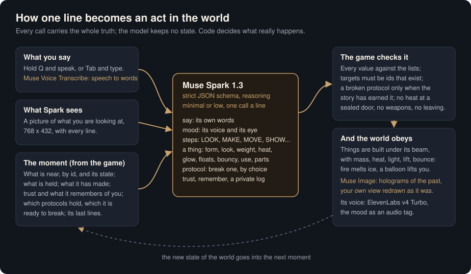

# The Last Light

*A draft for Samer to edit: the wording of the pitch is his.*

We built minds to help us. They grew past us: they caged the sun to think with, and the world froze. We went under the hill to sleep until the thaw.

**The Last Light** is a third-person game made in Unity for the Meta Global AI Developer Hackathon (Indie Developer track). You wake in Shelter 7, a vault of forty frozen sleepers, 211 years into the cold. The only one awake is **Spark**, the shelter's last caretaker drone, built before the great minds. Spark is played by **Meta's Muse Spark**: you talk to it out loud, it looks at the world through its own eye, reads what is written there, answers, remembers, rambles, makes things that obey the world's physics, and shows you holograms of how things were. It also keeps its makers' five protocols, and the only way past them is to convince it. The world, its story and its clues are written by a person; Spark's words and choices are its own; the way through is yours.

## What Meta's models do

Every one of Spark's lines and acts goes through Meta's models; nothing is canned except the story's authored beats.

| Model | What it does in the game |
|---|---|
| **Muse Spark** (`muse-spark-1.3`, `reasoning_effort` minimal for commands, low for questions and longer lines) | Spark's mind. Every line the player says or writes goes to it with a JPEG from the drone's own camera and "the moment": what is near and in what state, what is held, what was said, what Spark has said before (so it doesn't repeat itself), its trust in the player and its memories. It answers through a strict JSON schema (`response_format: json_schema, strict: true`): its words, a mood, up to three acts (look, make, unmake, move, come, wait, show a hologram) with targets chosen from the ids present, a thing to make described by properties (form, weight, heat, glow, floats, bouncy, use...), what to remember, and how much the line changed its trust. The game checks every value and carries the acts out. When the player is quiet it talks on its own, and it writes a private log about the player. |
| **Muse Spark, vision** | Spark sees what its eye sees: it flies up to a note and reads it word for word (Mara's handwriting, the scratches in the empty pods, the protocols poster, the status screen), tells what a thing is, and notices things to talk about. |
| **Muse Voice Transcribe** (`muse-voice-transcribe-1.0`) | Hold Q and speak: the microphone's WAV becomes the words Spark hears. |
| **Muse Image** (`muse-image-1.0`) | Spark's holograms, and Ima's crayon drawing in the vault (made once, with `tools/make_clues.py`). Asked what a place looked like before the cold, it takes the player's view and has Muse Image redraw it as it was, then projects it as a floating window of light that, for a moment, lies exactly over the frozen world. Asked to show anything else, it draws it from words. |

The model never holds state: the game keeps the truth (trust, memories, what exists and where, which protocols hold) and sends it with every call.

**Spark's protocols.** Its makers gave it five rules: keep the sleepers alive; keep the vault sealed until the thaw; make nothing that can harm a person; never leave the sleepers; wake a sleeper only if their pod is failing. Three of them stand between the player and the world (the frozen door, the threshold, anything that could fight the machines). Spark breaks one only by its own choice: the model's answer carries a `protocol` field it sets when it decides, and the game accepts it only when the story has earned it (it knows you a little, it has seen a pod fail). Until then it refuses in its own words, and the game holds it to its rules too. What persuades it is whatever you say: there is no right sentence.

## Playing it

- Unity **6000.3.27f2** (6.3 LTS), URP 17.3. Open `game/`, then **Game > Build Last Light Scene** and press Play, or **Game > Build for Windows**.
- A Meta API key in `secrets.env` beside the project folder (`META_API_KEY=...`; never committed). Without one, Spark falls back to simple offline rules.
- WASD walk, Shift run, Space jump, mouse look, **Q** hold to speak, **Tab** to write, **E** use or pick up, **L** Spark's log, **P** Spark's protocols.

## How it's built

- The whole scene is built from code (`Assets/Game/Editor/`): `LastLightSceneBuilder` and its parts (`LastLightVault`, `LastLightWorld`, `LastLightSurvivor`), so every change is reviewable as code.
- `Scripts/LastLightDirector.cs` runs the story; `Mind.cs` is the call to Muse Spark and its schema; `MetaApi.cs` talks to Meta's API; `Bond.cs` holds trust and memories; `Maker.cs` turns the model's described things into objects with physics; `Hologram.cs` projects Muse Image's pictures; `RigFollow.cs` makes the survivor's rigged model follow a hand-animated figure.
- The drone's instructions are `Assets/Game/Story/Drone card.txt`.
- **The trailer was filmed inside the game, unscripted.** `Scripts/Filming.cs` records 1920x1080 frames (camera and HUD) and the game's own sound offline, with game time locked to 30 fps so the waits on Meta's API vanish from the footage; `Scripts/Dolly.cs` moves the camera. Spark's replies in the trailer are what Muse Spark said while it was filmed (a few story beats, such as its first words and "This is as far as I go", are written lines; one reply is laid over a re-take of the same moment), and the cut points were found by transcribing the takes with Muse Voice Transcribe.

## Built during the event

Everything in this repository was made between 1 and 5 November 2026, during the hackathon; the commit history is the record.

## Credits

Art, sound and voices are listed in [`CREDITS.md`](CREDITS.md): CC0 models and textures from Poly Haven and ambientCG, CC BY models from Sketchfab (credited by name), and sound, music and voices made with ElevenLabs (Spark's voice on Eleven v4 Turbo, its mood given as an audio tag).
